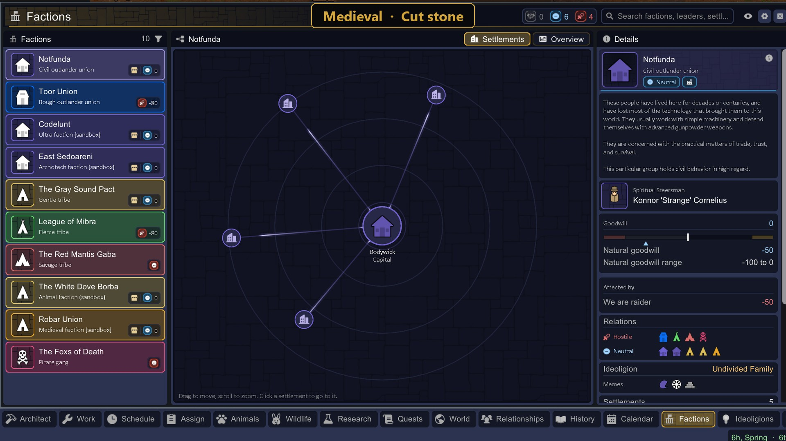

# UI Rethemed - Era Looks

Give early colonies rough wood and stone, then move on to steel panels and etched circuits as they advance.

This RimWorld add-on for Lazy Friday Studio's **UI Rethemed** gives each of the seven tech levels its own palette and pattern. Each pattern is a plain material texture that suits the level, and it changes as your colony advances. Your own UI Rethemed colours stay saved and come back whenever you turn this off.

> [!IMPORTANT]
> The era looks show across the UI Rethemed suite.
>
> - Main Bar, Factions, History, Notifications, Relationships and Work get the full look. Ideology gets the palette.
> - Architect, Animals, Colonist Card, Inspector Tabs, Quests and Wildlife still carry their own copy of the theme. This mod copies the era's colours and pattern into them until Lazy Friday Studio moves them onto Core.
> - If one of those mods changes how it draws its theme in an update, it keeps its own look until this mod catches up, and the game log names it.

## Features

- Seven era looks, one per tech level, each a palette and a pattern for UI Rethemed - Core.
- The look follows your colony's tech level and changes the moment research or a mod such as VFE Tribals raises it.
- Your own pick in UI Rethemed - Core is never overwritten. It shows at the main menu and whenever Follow the era is off.
- Optionally, in the UI Rethemed - Factions window, each faction shows the pattern for its own tech level.
- Items you can't use still show Core's line hatching while an era pattern is on.
- Colours that show a state, such as need bars and health, keep the standard green, so a full bar and a half-empty one still look different.
- Choose the palette and pattern for each era yourself, from every one UI Rethemed - Core has, or keep your own pick for an era. The settings show a preview and the palette colours for each tech level.
- Four stone wall patterns to choose from as well: castle ashlar, coursed drystone, random rubble and levelled rubble.

| Tech level | Look |
| --- | --- |
| Animal | Fieldstone on charcoal and bone. |
| Neolithic | Split wood on dark rock, with red ochre and yellow ochre. |
| Medieval | Cut stone on lapis blue and gold. |
| Industrial | Bolted plates of diamond tread plate on iron grey and steel. |
| Spacer | Hull panels on deep blue and cyan. |
| Ultra | Hex tiles on deep plum and magenta. |
| Archotech | Etched circuits on olive grey and lime. |

UI Rethemed tints the textures with the active palette and draws them behind text and icons. They drift slowly along title bars when animations are on. The older rock art, tapestry and engraving figure patterns are still in the pattern lists if you prefer them.

## Requirements

- RimWorld 1.7.
- [Harmony](https://steamcommunity.com/sharedfiles/filedetails/?id=2009463077).
- [UI Rethemed - Core](https://steamcommunity.com/sharedfiles/filedetails/?id=3832843406) by Lazy Friday Studio, version 1.10.0 or later.

UI Rethemed - Factions is optional. The faction patterns only show when it's loaded. No DLC is needed.

## Installation

Subscribe on the [Steam Workshop](https://steamcommunity.com/sharedfiles/filedetails/?id=3840498215) and load it after UI Rethemed - Core. RimWorld sorts this for you.

## Usage

- Load a save or start a game. The look matches your colony's current tech level straight away.
- Research or an era advance from a mod such as VFE Tribals or Node Research switches it on the spot.
- To pick a look yourself, turn off Follow the era, then choose a palette and pattern in **Options > Mod options > UI Rethemed - Core**. The era looks sit at the end of each list.

## Configuration

In **Options > Mod options > UI Rethemed - Era Looks**:

- **Follow the era** (on by default): while a game is loaded, shows the look for your colony's tech level in place of your own pick.
- **Show each faction's era** (off by default): in the UI Rethemed - Factions window, each faction's list row, header card and icon boxes show the pattern for that faction's tech level. A selected faction's graph pages and leader card show its pattern too.
- **Look for each era**: a palette and a pattern for each tech level, animal through archotech. Each opens a list of every palette or pattern UI Rethemed - Core has, plus **Your own pick** to keep yours for that era. **Reset to defaults** puts the era looks back.

While UI Rethemed - Core's settings page is open, your own pick shows, so changes you make there appear as you make them. Core's settings say Era Looks is overriding the look.

### Auto Mod Config

Supports [Auto Mod Config (Continued)](https://steamcommunity.com/sharedfiles/filedetails/?id=3586136174), so a mod list can ship its own look for each era.

- Settings file: `Mod_3840498215_EraLooksMod.xml`, or `Mod_<folder>_EraLooksMod.xml` for a local copy.
- Class: `EraLooks.EraLooksSettings`.
- Keys: `followEra` (`True` or `False`), and a palette and a pattern per era: `animalPalette` and `animalPattern`, and the same pair for `neolithic`, `medieval`, `industrial`, `spacer`, `ultra` and `archotech`.

Each palette or pattern key takes a defName, such as `UIRethemedCore_Slate` or `EraLooks_Tapestry`, or `OwnPick` for the player's own. A key that is left out keeps the era look made for that era.

## Compatibility and save safety

- The note at the top lists which UI Rethemed mods change look, and how.
- Safe to add to or remove from an existing save. Nothing is stored in your save; your settings live in the mod settings.
- If you remove the mod while an era pattern is picked by hand, UI Rethemed - Core goes back to its honeycomb. Colours you applied from an era palette stay as your own colours.
- The faction patterns need the UI Rethemed - Factions update from 16 November 2026 or later. With an older Factions, the mod writes one warning to the log and factions show your colony's pattern. The pattern behind each row of the faction list still hooks into how Factions draws that list. If a Factions update changes the list, the rows lose that pattern and the mod writes one warning to the log.
- Not related to combat, so Combat Extended makes no difference.

## Credits

UI Rethemed and its Core palette and pattern system are by Lazy Friday Studio. This mod adds to their work and isn't an official part of it.

## License

Released under the **GNU General Public License v3.0**. See [`LICENSE`](LICENSE) for the complete terms.

Commercial use is allowed. Distributed modified versions must remain under GPLv3 and make corresponding source available as required by the license.

## AI?

Do I use AI to build my mods? **Yes.**  
Am I obsessive about how I use it and the quality of the results? **Also yes.**

I understand the scepticism.
I've seen the flood of AI-generated mods that look like someone typed a prompt, uploaded whatever came out, and called it done.

That bothers me too.

My workflow involves a lot of iteration, review, and testing. The same care I'd put into building everything by hand. I've spent hundreds of hours building mods. Using AI doesn't lower the standard I expect from my work.

## Links

Source code: [GitHub](https://github.com/KyleMHB/UI-Rethemed-Era-Looks)

Support me on Ko-fi.

